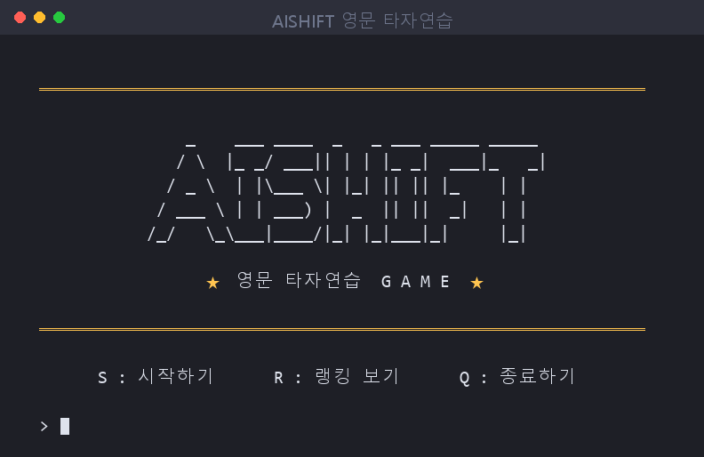
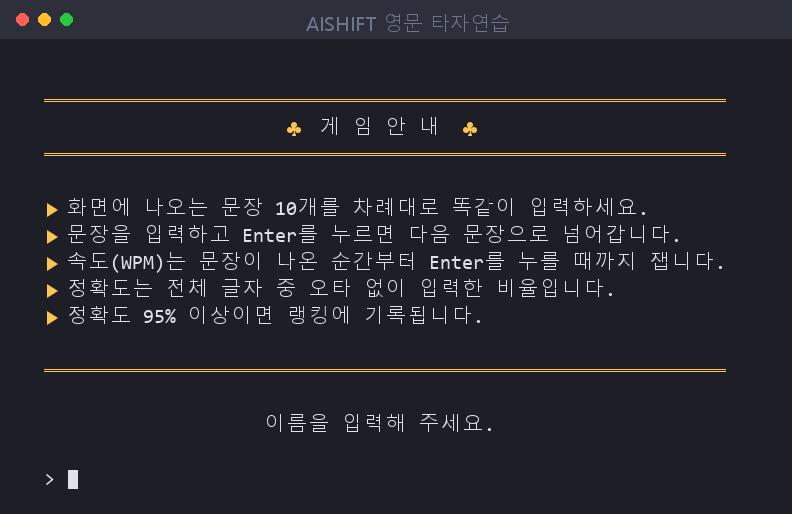
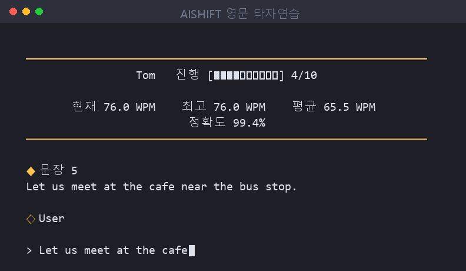
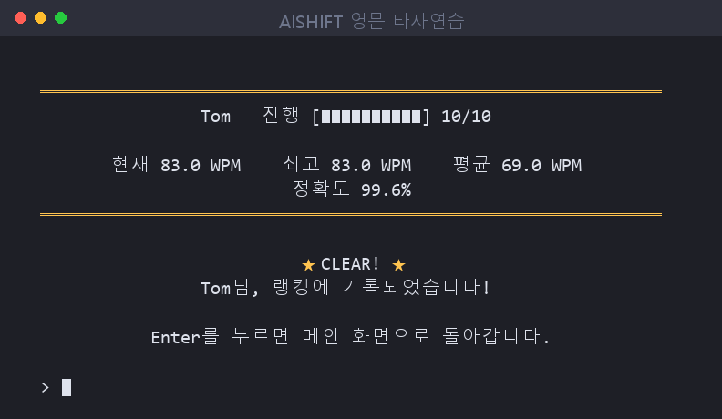
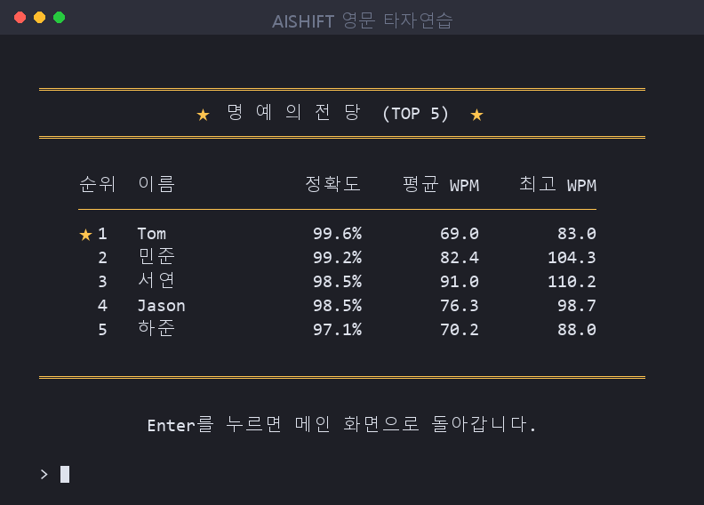

# AISHIFT 영문 타자연습 게임

터미널에서 즐기는 **영문 타자연습 게임**입니다.
화면에 나오는 영어 문장 10개를 똑같이 입력하면 타수(WPM)와 정확도를 계산해 주고,
정확도 95% 이상이면 **랭킹(명예의 전당)** 에 이름을 남길 수 있습니다.

파이썬 기본 문법(변수, 조건문, 반복문, 함수, 리스트, 파일 읽고 쓰기)만으로 만들었기 때문에,
**파이썬을 처음 배우는 학생들이 코드를 읽으며 공부하기에 좋습니다.**

## 스크린샷

| 타이틀 | 게임 안내 |
|:---:|:---:|
|  |  |

| 플레이 화면 | 결과 화면 |
|:---:|:---:|
|  |  |

| 랭킹 |
|:---:|
|  |

> 스크린샷은 프로그램의 실제 출력 내용을 이미지로 그려 만든 것입니다. 실제 콘솔에서는 글꼴과 색이 다르게 보일 수 있습니다.

## 실행 방법

### 준비물

- Python 3 (3.8 이상 권장)
- **Windows** 터미널 (화면을 지울 때 `cls` 명령을 쓰기 때문입니다)

> macOS / Linux에서 실행하려면 `main.py`의 `clear()` 함수 안 `os.system("cls")`를 `os.system("clear")`로 바꾸세요.

### 실행

```bash
python main.py
```

한글과 `■ □ ★` 같은 기호가 깨지면 터미널 글꼴/인코딩을 확인하세요. (Windows Terminal 권장)

## 사용 방법

시작 화면에서 알파벳 하나를 입력합니다. (대문자, 소문자 모두 가능)

| 입력 | 동작 |
|:---:|---|
| `S` | 게임 시작 (안내를 읽고 이름을 입력하면 시작) |
| `R` | 랭킹 TOP 5 보기 |
| `Q` | 프로그램 종료 |

### 게임 규칙

1. 이름을 입력하면 영어 문장 **10개**가 무작위로 나옵니다.
2. 문장을 보고 똑같이 입력한 뒤 **Enter**를 누르면 다음 문장으로 넘어갑니다.
3. 화면 맨 위에서 현재 타수, 최고 타수, 평균 타수, 정확도, 진행 상황을 볼 수 있습니다.
4. 10문장을 모두 끝내면 결과가 나오고, 조건을 만족하면 랭킹에 기록됩니다.

### 점수 계산

- **타수(WPM)** = (입력한 글자 수 ÷ 5) ÷ 걸린 시간(분)
  - 영어는 5글자를 1단어로 계산합니다.
  - 문장이 화면에 나온 순간부터 Enter를 누를 때까지 걸린 시간을 잽니다.
- **정확도(%)** = 오타 없이 입력한 글자 수 ÷ 전체 글자 수 × 100
  - 같은 위치의 글자가 같으면 맞게 친 것으로 봅니다. 글자가 모자라거나 넘치면 오타입니다.

### 랭킹 규칙

1. 정확도가 **95% 미만**이면 기록하지 않습니다.
2. **정확도**가 높은 사람이 더 높은 순위입니다.
3. 정확도가 같으면 **평균 WPM**이 높은 사람이 더 높은 순위입니다.
4. 평균 WPM도 같으면 **최고 WPM**이 높은 사람이 더 높은 순위입니다.

랭킹은 `ranking.txt`에 한 줄씩 저장됩니다. (`이름,정확도,평균WPM,최고WPM`)
기록을 초기화하려면 이 파일을 지우면 됩니다.

## 파일 구성

```
.
├── main.py          # 게임 전체 코드
├── text.txt         # 연습용 영어 문장 목록 (한 줄에 한 문장)
├── ranking.txt      # 랭킹 기록 (처음 기록이 생길 때 자동으로 만들어짐)
├── screenshots/     # README에 쓰인 스크린샷
└── README.md
```

## 내 입맛대로 바꿔 보기

### 연습 문장 바꾸기

`text.txt`를 열어 한 줄에 한 문장씩 쓰면 됩니다. 빈 줄은 무시됩니다.
(파일은 UTF-8로 저장하세요.)

### 설정 값 바꾸기

`main.py` 맨 위의 값을 바꾸면 됩니다.

```python
COUNT = 10          # 한 번에 테스트할 문장 수
MIN_ACCURACY = 95   # 이 정확도 미만이면 랭킹에 기록하지 않음
TOP = 5             # 랭킹에 보여줄 인원 수
```

## 코드 읽는 순서 (학습자용)

`main.py`는 구역별로 구분선과 주석이 달려 있습니다.

1. **화면 출력** — `clear`, `ask`, `width`, `center`, `show_title`
2. **기록 계산** — `average`, `accuracy`, `show_status`
3. **랭킹** — `load_records`, `save_record`, `is_higher`, `show_ranking` (버블 정렬 직접 구현)
4. **타자 테스트** — `intro`, `typing_test`
5. **메인** — 맨 아래 `while True:` 반복문

### 도전 과제

- 정답 문장과 비교해서 틀린 글자를 다른 색으로 보여 주기
- 문장 수를 시작할 때 고르게 하기
- 랭킹에 날짜도 함께 기록하기
- 같은 이름의 기록은 가장 좋은 것 하나만 남기기
