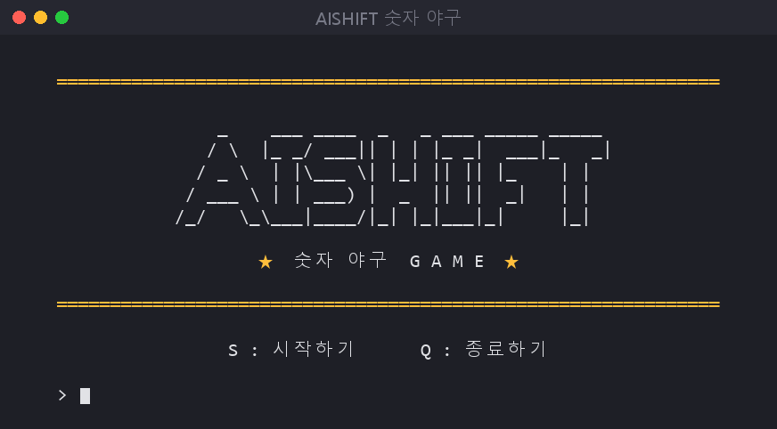
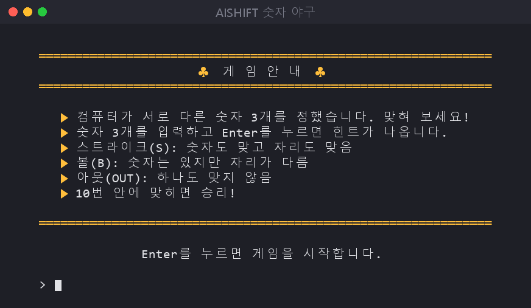
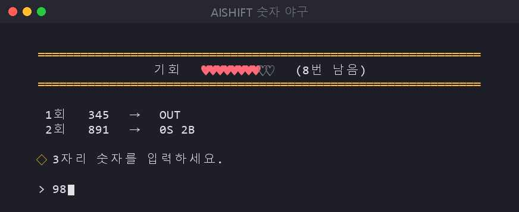
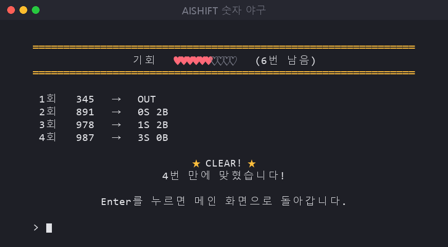
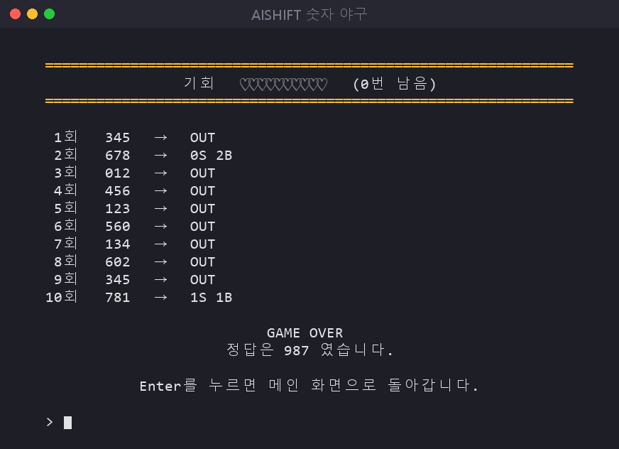

# AISHIFT 숫자 야구 게임

터미널에서 즐기는 **숫자 야구 게임**입니다.
컴퓨터가 정한 서로 다른 3자리 숫자를 힌트(스트라이크 / 볼 / 아웃)만 보고 10번 안에 맞히세요.
파이썬 기본 문법만 사용했습니다.

## 스크린샷

| 타이틀 | 게임 안내 |
|:---:|:---:|
|  |  |

| 플레이 화면 | 클리어 |
|:---:|:---:|
|  |  |

| 게임 오버 |
|:---:|
|  |

> 스크린샷은 프로그램의 실제 출력 내용을 이미지로 그려 만든 것입니다. 실제 콘솔에서는 글꼴과 색이 다르게 보일 수 있습니다.

## 실행 방법

- Python 3 (3.8 이상 권장), **Windows** 터미널 (화면을 지울 때 `cls` 사용)
- macOS / Linux: `main.py`의 `os.system("cls")`를 `os.system("clear")`로 바꾸세요.

```bash
python main.py
```

시작 화면에서 `S`를 입력하면 안내 후 바로 게임이 시작되고, `Q`를 입력하면 종료합니다.

## 게임 규칙

1. 컴퓨터가 `0~9` 중 **서로 다른 숫자 3개**를 정합니다. (예: `407`)
2. 3자리 숫자를 입력하면 힌트가 나옵니다.
   - **스트라이크(S)**: 숫자도 맞고 자리도 맞음
   - **볼(B)**: 숫자는 있지만 자리가 다름
   - **아웃(OUT)**: 하나도 맞지 않음
3. **10번** 안에 `3S`를 만들면 CLEAR, 못 맞히면 GAME OVER(정답 공개)입니다.
4. 3자리가 아니거나 같은 숫자가 겹치면 기회를 쓰지 않고 다시 입력합니다.
5. 남은 기회는 화면 위쪽에 하트로 표시됩니다. (`♥♥♥♥♥♥♥♡♡♡` = 7번 남음)

예) 정답이 `407`일 때 `470` → `1S 2B`, `123` → `OUT`

## 설정 바꾸기

`main.py` 맨 위의 값을 바꾸면 됩니다.

```python
DIGITS = 3        # 맞혀야 하는 숫자 자릿수 (4로 바꾸면 더 어려워요)
MAX_TRIES = 10    # 허용되는 시도 횟수
```

## 파일 구성

```
.
├── main.py          # 게임 전체 코드
├── screenshots/     # README에 쓰인 스크린샷
└── README.md
```
